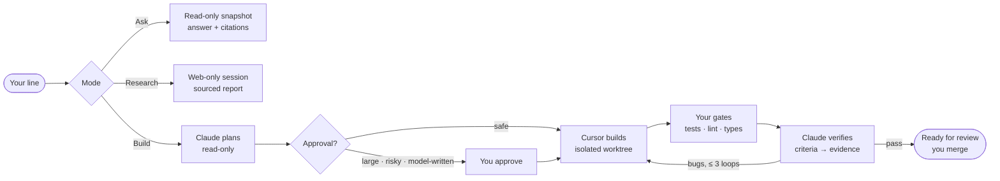

<div align="center">


<br>


<!-- Live repo metrics: every badge below is fetched from GitHub/shields.io on page load, nothing is hard-coded. -->
<a href="https://github.com/TechTeamConductor/Conductor/releases"></a>
<a href="https://github.com/TechTeamConductor/Conductor/actions/workflows/release.yml"></a>
<a href="https://github.com/TechTeamConductor/Conductor/stargazers"></a>
<a href="https://github.com/TechTeamConductor/Conductor/forks"></a>
<a href="https://github.com/TechTeamConductor/Conductor/watchers"></a>
<a href="https://github.com/TechTeamConductor/Conductor/graphs/contributors"></a>
<a href="https://github.com/TechTeamConductor/Conductor/commits/main"></a>
<a href="https://github.com/TechTeamConductor/Conductor/commits/main"></a>
<a href="https://github.com/TechTeamConductor/Conductor/issues"></a>
<a href="https://github.com/TechTeamConductor/Conductor"></a>
<a href="https://github.com/TechTeamConductor/Conductor"></a>

**[Quick start](#quick-start)** · **[What you get](#what-you-get)** · **[How it works](#how-it-works)** · **[Screens](#screens)** · **[Safety](#safety-model)** · **[Status](#status)** · **[Docs](#documentation)**

</div>

---

# Conductor

> **Type one line. Claude plans it, Cursor builds it, Claude checks it, and you merge it.**
> One local dashboard that runs your AI coding CLIs as a team, with its own board, and never touches `git push`.

You do the thinking. Conductor does the shuffling between tools: it plans, splits work into dependent tasks, builds in an **isolated git worktree**, runs **your** tests as ground truth, has a **second agent verify** the result, and sends bugs back automatically, up to three times, before it asks you.

```text
   "Add filters by user and date to the audit log"
        │
        ▼  Claude   reads a read-only snapshot, writes the plan   (+ independent plan review for bigger changes)
        ▼  You      approve only what is large, risky or came from model-written text
        ▼  Cursor   builds in its own worktree and branch
        ▼  Gates    your tests · lint · typecheck — deterministic, not an opinion
        ▼  Claude   verifies every acceptance criterion against evidence
        │              └─ bugs? → bug cards → back to Cursor (max 3 loops, then it asks you)
        ▼  Ready for review — a branch waiting for you. Conductor never merges it.
```

## Why Conductor?

- **A second pair of eyes.** The tool that writes the code is never the tool that signs it off.
- **Your tests decide.** Gates run your repo's own checks; the verifier must cite evidence, not vibes.
- **It stays on your machine.** Loopback only, one-time sign-in link, cookie + CSRF. No cloud, no tracker, no account.
- **Safe by construction.** The builder works in a worktree, cannot push, and its branch is scanned for secrets and protected files before you ever see it.
- **Bring your own tools.** Claude Code and Cursor today; roles, models and effort are configurable per job, discovered from the CLIs themselves, never hard-coded.
- **Zero runtime dependencies.** Plain Node. Nothing to `npm install` to run it.

## What you get

| | Feature | What it does |
| --- | --- | --- |
| 💬 | **Home composer** | One box for everything. **Auto** picks Ask, Build or Research from your line, or you choose. Answers appear as a thread, with the branch and commit they were based on. |
| ❓ | **Quick Ask** | Questions about your code, answered from a read-only snapshot with file citations. No task, no worktree. "Turn into a task" when you want a change. |
| 🧭 | **Design the work** | One line → repo check → detailed brief → up to **8 ordered parts with dependencies** → untick what you don't want → **Send N tasks** as linked cards. Always waits for your approval. |
| 🔎 | **Deep Research** | Web-only research in an empty folder: a short brief you review, Standard or Deep depth, and a report where every source is marked **Opened**, **Listed** or **Unverified**. |
| 🗂️ | **Native board** | Backlog · To do · working stages · Needs you · Ready for review. Task graphs, dependencies, notes, retries. No Linear. |
| 🎛️ | **Who does what** | Seven jobs, each with a **tool · model · effort**. A "Runs as …" line shows the exact command it becomes. |
| 🔌 | **Model discovery** | Conductor asks each CLI which models it offers, per account. Stale lists are marked, never invented. |
| 👥 | **Several accounts per tool** | At a usage limit it moves to the next account, then the next tool *in that job's list*, or waits. Pauses and resumes by itself. |
| ⚡ | **Run mode** | **Per settings** or **Complete auto**. Complete auto never removes a safety hold. Large, risky, protected-path and model-written plans still ask. |
| 🧠 | **Project context** | A local, incremental index of your repo so agents don't rescan it every time. Works offline. |
| 🛡️ | **Approval policies** | `full-auto` · `approve-plan` · `approve-risky` · `manual-stages`, per project, with forced holds no setting can remove. |

## Download

Grab the latest build from [**Releases**](https://github.com/TechTeamConductor/Conductor/releases): a macOS `.dmg` (Apple Silicon) and an experimental Windows `.exe`. Every release comes with a `SHA256SUMS.txt`. Releases are cut automatically from the commit history, and while the version is below 1.0.0 they are marked *pre-release* on purpose. Neither app is code-signed yet, so macOS asks you to right-click → Open the first time and Windows SmartScreen will warn.

## Quick start

> About five minutes, once. Node **22.18+**, plus the CLIs you already use.

```bash
# 1. Sign in to your tools (you probably already have)
claude            # Claude Code: run once and sign in
agent login       # Cursor CLI

# 2. Try it with scripted agents. No keys, no quota
git clone <this-repo> conductor && cd conductor
npm run demo

# 3. Start for real
npm start         # opens the dashboard and walks you through setup
```

The dashboard checks that Claude and Cursor are signed in, asks you to add a repository folder (tests and lint are auto-detected), and you're ready. Press **Home**, write one line, and go.

| Where | What |
| --- | --- |
| Data | `~/.conductor-v2` (override with `CONDUCTOR_HOME`) |
| Port | `4327` (loopback only) |
| Desktop app | Download the `.dmg` (macOS) or the experimental `.exe` (Windows) from [**Releases**](https://github.com/TechTeamConductor/Conductor/releases). Build it yourself with the steps in [`docs/DESKTOP.md`](docs/DESKTOP.md) |
| Coming from v1? | `node bin/conductor.mjs migrate` (dry run first). v1 and v2 run side by side and v2 never writes to v1's folder |

## Screens

<table>
<tr>
<td width="50%"><br><sub><b>Home.</b> One composer: Auto, Ask, Build or Research.</sub></td>
<td width="50%"><br><sub><b>Board.</b> Cards move by themselves as the agents work.</sub></td>
</tr>
<tr>
<td width="50%"><br><sub><b>Build.</b> A line becomes a planned, gated task.</sub></td>
<td width="50%"><br><sub><b>Research.</b> Every source is marked Opened, Listed or Unverified.</sub></td>
</tr>
<tr>
<td colspan="2"><br><sub><b>Settings.</b> Tool · model · effort per job, with the exact command it runs as.</sub></td>
</tr>
</table>

<sub>Screenshots come from the built-in demo with scripted agents.</sub>

## How it works



**Roles, not hard-wired tools.** Every job (planning, review, verification, implementation, debugging, documentation, requirements, context, architecture, research) has an ordered list of providers. Who may hold which job is decided by **code, not a setting**: a job that writes code accepts only a tool whose no-push isolation has been proven.

| Provider | Plans · reviews · verifies | Builds code | Research | Status |
| --- | :---: | :---: | :---: | --- |
| **Claude Code** | ✅ read-only, locked down | 🔒 locked | ✅ web-only profile | Supported |
| **Cursor** | ✅ fallback for read-only stages | ✅ proven by a live adversarial suite | 🔒 locked | Supported |
| **Codex** | ⚠️ optional, read-only, *unverified* | 🔒 locked | 🔒 locked | Experimental |

<sub>🔒 = refused with the real reason, until its own isolation profile and live suite exist.</sub>

## Safety model

Conductor assumes the model can be wrong, and that text it writes can be hostile.

| Rule | How |
| --- | --- |
| **Local only** | Listens on `127.0.0.1`, one-time sign-in link, `HttpOnly` cookie, CSRF on every change. |
| **Read-only stages stay read-only** | Claude runs with `Read`, `Grep`, `Glob` only: no MCP, skills or plugins; credential files denied. A **fail-closed startup check** refuses to continue if the session isn't what was asked for. |
| **The builder cannot push** | Own worktree and branch in a v2-only namespace, deny rule plus environment. Git hooks and config are snapshotted and restored around every build. |
| **Branches are scanned** | Secrets and changes to protected files (`.claude/`, `.cursor/`, `AGENTS.md`, CI config…) are **held for you**. |
| **Model text is untrusted** | Briefs, research and answers are labelled as model-written. Cards made from them **always wait for your approval**, under every policy and mode. |
| **Nothing leaks across accounts** | Each child process gets an allow-listed environment; credentials never reach another account's process, config, logs or UI. |
| **Everything is redacted** | Every agent-derived string is scrubbed before it reaches the board, logs or UI. |
| **Data is versioned and backed up** | Newer files are refused, never downgraded. Older files are backed up before an upgrade. |

Read the safety section of the [full guide](docs/GUIDE.md#safety-model-read-this-once) once before pointing it at a repo.

> **Heads-up.** Like any coding agent, Cursor can run commands as you inside the worktree. Only register repositories you trust.

## Status

**Preview.** Honest labels, no overclaiming:

| Area | State |
| --- | --- |
| Board, planning, build, verify, bug loops | ✅ Done |
| Task graphs, project context, offline mode | ✅ Done |
| Quick Ask, Deep Research, Design the work | ✅ Done (one opt-in live check still pending) |
| Model and effort per job, model discovery | ✅ Done |
| Several accounts, limit rules, run mode | ✅ Done, but **signing in extra accounts is switched off** until its live checks pass |
| New UI (Home, Board, Settings) | ✅ Done and browser-checked on the demo |
| macOS app | ✅ `.dmg` (Apple Silicon), built automatically for every release. Ad-hoc signed, not notarized |
| Windows app | 🟡 Experimental `.exe` installer: unsigned and **unverified**; secret storage, notifications and the background service are macOS-only |
| Linux package | ⬜ Not built |
| Codex as a builder · Cursor/Codex research | ⬜ Locked on purpose, one pairing at a time |
| Codex on a real install | ⚠️ Not yet exercised against a real Codex binary |

Tested with scripted fake agents and real git: **1,000+ tests, no network, no quota.** Live tests against the real Cursor CLI are opt-in (`npm run test:live`).

## Commands

```bash
npm start                      # run + open the dashboard
npm run open                   # open a fresh signed-in tab while it's running
npm run demo                   # scripted agents, no keys, no quota
npm run doctor                 # check the setup  (--isolation proves Claude is locked down)
npm test                       # unit + end-to-end tests (fake agents)
npm run check                  # type check

node bin/conductor.mjs models [--refresh]                       # what each CLI says it offers
node bin/conductor.mjs accounts list | add | check | move | remove
node bin/conductor.mjs migrate [--apply]                        # import a v1 folder side by side
node bin/conductor.mjs service install | uninstall | status     # keep it running (launchd)
```

## Documentation

| Read | For |
| --- | --- |
| [**Full guide**](docs/GUIDE.md) | Everyday use, roles and providers, accounts, every command, the whole safety model |
| [Architecture](docs/ARCHITECTURE.md) | Modules, data on disk, the router, known limits |
| [API](docs/API.md) | Every endpoint, the transport and security rules the UI follows |
| [Desktop app](docs/DESKTOP.md) | The Electron shell, the `.dmg` / `.exe` builds and how releases are versioned |
| [Troubleshooting](docs/TROUBLESHOOTING.md) | When something looks wrong |

## Star history

<a href="https://www.star-history.com/#TechTeamConductor/Conductor&Date">
  <picture>
    <source media="(prefers-color-scheme: dark)" srcset="https://api.star-history.com/svg?repos=TechTeamConductor/Conductor&type=Date&theme=dark" />
    
  </picture>
</a>

## Built with

Plain **Node ≥ 22.18** running **TypeScript by type stripping** (erasable syntax only, no build step) and a vanilla-JS dashboard. **Zero runtime dependencies**. The only dev dependencies are `typescript` and `@types/node`. Prompts are plain files in [`prompts/`](prompts/): edit them there, not in code.

---

<div align="center">

**Local · reviewed · reversible**

<sub>Nothing is pushed, opened as a PR, or merged unless you do it yourself.</sub>

</div>